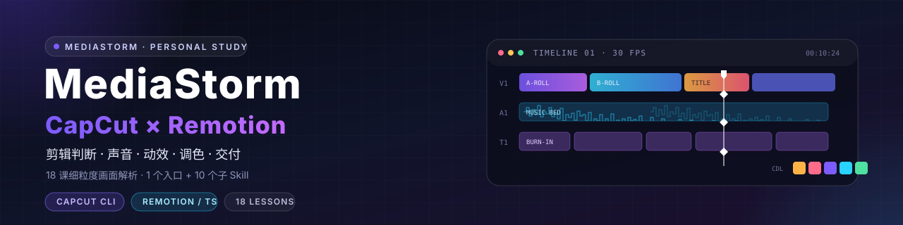
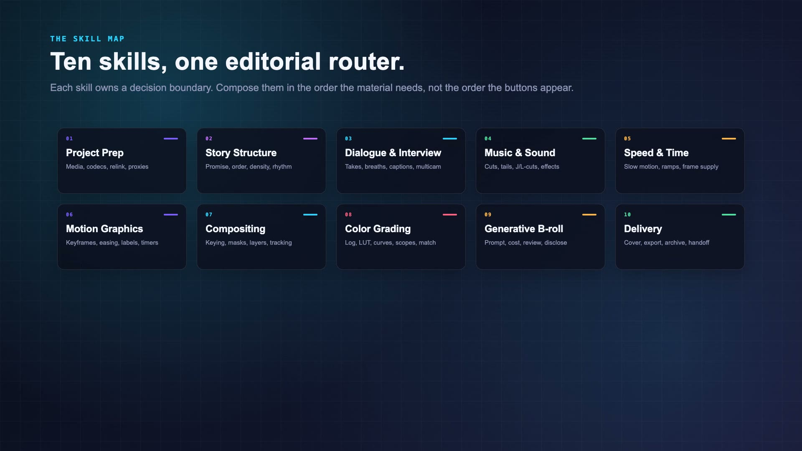

# mediastorm-capcut-skill



[](LICENSE)
[](skills/)
[](notes/visual-analysis/README.md)
[](HANDOFF.md)
[](https://github.com/renezander030/capcut-cli)
[](https://www.remotion.dev/)

把影视飓风（MediaStorm）付费剪映课程中的**剪辑判断、手法、调色与交付知识**，整理成可在 **CapCut** 与 **Remotion** 两条路径落地的组合 Skill。

> ⚠️ 个人学习项目，非官方、非商业。课程视频、字幕、截图与抽帧只保留在被忽略的 `cheese/`，不进入仓库或 Skill 包。详见 [SECURITY.md](SECURITY.md)。

## 这是什么

- **18 课、6,198 条字幕、6,656 个 2 秒采样帧、1,658 张时间码索引页**的细粒度画面解析。
- **1 个入口 Skill + 10 个按任务边界划分的子 Skill**，不是按按钮或课号硬分。
- 两条实现路径：
  - **CapCut**：`capcut-cli` + `capcut-edit` + 本组合 Skill，负责草稿读写、判断与验收。
  - **Remotion**：React / TypeScript 组合，使用 `@remotion/media`、`@remotion/transitions`、`@remotion/captions`、`@remotion/effects` 等官方包。
- 课程知识以原创归纳为主，逐课细节见 [18 课细粒度画面解析](notes/visual-analysis/README.md)。

> 证据边界：本轮完成的是**静态画面层**取证，不是连续视频理解，也没有原声听辨。Remotion 路径已有**合成素材示例并完成渲染**，但仍不代表课程素材、CapCut 路径或平台验收；CapCut 路径有课程画面证据，但同样不等同于剪映最终听视觉验收。

## 支持的两条路径

| 环节 | CapCut 路径 | Remotion / TypeScript 路径 | 当前证据 |
| --- | --- | --- | --- |
| 工程与素材 | `capcut-cli` 读草稿；`capcut-edit` 做通用写入 | `mediabunny` 读时长/尺寸；`calculateMetadata` 设画布与时长；`staticFile()` 管素材 | CapCut 已实测；Remotion 示例已渲染（合成素材） |
| 时间线 | CapCut 多轨、主轨磁吸、复合片段 | `<Sequence>` / `<Series>` / `TransitionSeries` | CapCut 有画面证据；Remotion 示例已渲染 |
| 口播与字幕 | 智能剪口播、字幕识别、安全区 | `@remotion/captions` 的 `Caption` 类型；SRT 导入；`@remotion/layout-utils` | CapCut 有画面证据；Remotion 示例已渲染字幕 |
| 声音 | 音频轨、复合片段、回音、声道配置 | `@remotion/media` 的 `<Audio>`；`trimBefore`、`volume`、`playbackRate`；`@remotion/media-utils` | CapCut 有画面/波形证据；**未听辨**；Remotion 示例仅有合成环境音 |
| 变速 | 常规变速、曲线变速、智能补帧 | `<Video playbackRate>`、`trimBefore`、`durationInFrames`；`@remotion/motion-blur` | CapCut 有面板读数；Remotion 示例未覆盖变速 |
| 动效 | 关键帧、缓动、跟踪标签、数字闪变、计时器 | `interpolate`、`Easing`、`spring`、`useCurrentFrame`；`@remotion/shapes` | CapCut 有参数证据；Remotion 示例已渲染关键帧/曲线 |
| 抠像与跟踪 | 智能抠像、色度抠图、蒙版、混合模式、平面跟踪 | `@remotion/effects` 的 `colorKey` / `cornerPin`；平面求解需外部数据 | CapCut 有界面证据；Remotion 仅部分可映射 |
| 调色 | Log 还原、LUT、基础/HSL/色轮、曲线、示波器 | `colorCorrection()`、`lut()`、`@remotion/effects` | CapCut 有参数证据；Remotion 示例已渲染 colorCorrection |
| 生成式 B-roll | 剪映 AI 生成、手机 AI 特效 | 外部生成 API + `staticFile()`；`@remotion/player` 审看 | 仅录课界面证据；示例未覆盖生成 |
| 交付 | 封面、命名、导出、归档、跨端 | `@remotion/renderer`、`@remotion/cli`、`@remotion/lambda` | CapCut 有导出面板证据；Remotion 示例已渲染本地成片；平台规则需另查 |

## Remotion 示例视频

[](assets/demo/skill-atlas.mp4)

- **24 秒 / 1920×1080 / 30fps / H.264 + AAC**，完全使用合成素材，不含课程原片。
- 覆盖 6 个场景：标题、10 个 Skill 卡片、时间线与字幕、Log→调色对比、关键帧/曲线、渲染交付。
- 使用 `TransitionSeries`、`@remotion/media`、`@remotion/captions`、`@remotion/effects` 的 `colorCorrection()`。
- 工程源码：[remotion/README.md](remotion/README.md)；成片：[assets/demo/skill-atlas.mp4](assets/demo/skill-atlas.mp4)。
- 边界：这是 Remotion 实现路径的视觉冒烟测试，不证明 CapCut 路径、课程音轨或平台验收。

## Skill 安装

### 1. 安装到 `.agents` 技能目录

```bash
mkdir -p "$HOME/.agents/skills"
for dir in skills/mediastorm-*; do
  rsync -a "$dir/" "$HOME/.agents/skills/$(basename "$dir")/"
done
```

更新时重复执行即可；不带 `--delete`，不会删除你手动加在安装目录里的文件。Windows 可把 `rsync -a` 换成资源管理器复制或 `robocopy`。

当前机器的安装状态：11 个 `mediastorm-*` 已从 `~/.codex/skills` 卸载并移到 `~/.codex/uninstalled-skills/mediastorm-2026-10-26/` 备份，随后安装到 `~/.agents/skills/mediastorm-*`。`capcut-edit` 仍保留在 `~/.codex/skills/capcut-edit`，不随本组合 Skill 迁移。

### 2. 调用入口

```text
Use $mediastorm-capcut to route this CapCut or Remotion editing task.
```

入口按任务路由到 10 个子 Skill；复杂任务会组合多个子 Skill。例如：

```text
$mediastorm-capcut 帮我把这段口播做成 60 秒短片：
先用 CapCut 做语义粗剪，再给出 Remotion 版的字幕与调色实现。
```

### 3. 校验

```bash
python3 "$HOME/.codex/skills/.system/skill-creator/scripts/quick_validate.py" \
  "$HOME/.agents/skills/mediastorm-capcut"
```

### 4. 创建 Remotion 工程（可选）

```bash
npx create-video@latest --yes --blank --no-tailwind mediastorm-remotion
cd mediastorm-remotion
npm i
npx remotion add @remotion/media
npx remotion add @remotion/transitions
npx remotion add @remotion/captions
npx remotion add @remotion/effects
npx remotion add @remotion/layout-utils
npx remotion add @remotion/motion-blur
npx remotion add @remotion/shapes
npx remotion studio
```

> `npx remotion add` 会按当前 Remotion 版本解析依赖；不要手工拼装不兼容的版本。渲染属于另一个明确动作：`npx remotion render`。在 Studio 预览前，不要把它当作已交付。

## 10 个子 Skill × TypeScript 工具

| 子 Skill | 负责什么 | CapCut 落点 | Remotion / TypeScript 工具 |
| --- | --- | --- | --- |
| [`mediastorm-project-prep`](skills/mediastorm-project-prep/SKILL.md) | 素材盘点、编码/帧率、重链接、代理、接入门 | `capcut projects/info/materials/diagnose`；`capcut-edit` | `mediabunny`、`calculateMetadata`、`staticFile()`、`zod`、`@remotion/zod-types` |
| [`mediastorm-story-structure`](skills/mediastorm-story-structure/SKILL.md) | 叙事结构、信息密度、镜头组接、长短片节奏 | 时间线与多轨编排 | `@remotion/transitions`（`TransitionSeries`）、`Sequence`、`@remotion/layout-utils` |
| [`mediastorm-dialogue-interview`](skills/mediastorm-dialogue-interview/SKILL.md) | 口播、take、气口、字幕、多机位 | 智能剪口播、字幕识别、多机位 | `@remotion/captions`、`@remotion/media`、`@remotion/whisper-webgpu`、`@huggingface/transformers` |
| [`mediastorm-music-sound`](skills/mediastorm-music-sound/SKILL.md) | 音乐裁切、尾音、J/L-cut、环境声、响度 | 音频轨、复合片段、回音、声道配置 | `@remotion/media` 的 `<Audio>`、`@remotion/media-utils`、`mediabunny` |
| [`mediastorm-speed-time`](skills/mediastorm-speed-time/SKILL.md) | 常速变速、慢放、曲线变速、源帧率 | `capcut speed`、速度曲线 | `<Video playbackRate>`、`trimBefore`、`@remotion/motion-blur`、`mediabunny` |
| [`mediastorm-motion-graphics`](skills/mediastorm-motion-graphics/SKILL.md) | 关键帧、缓动、跟踪标签、数字闪变、计时器 | `capcut keyframe`、文字动画 | `interpolate`、`Easing`、`spring`、`@remotion/shapes`、`@remotion/motion-blur` |
| [`mediastorm-compositing-tracking`](skills/mediastorm-compositing-tracking/SKILL.md) | 抠像、蒙版、混合模式、图层、平面跟踪 | `matting`、`chroma`、`mix-mode` | `@remotion/effects`（`colorKey`、`cornerPin`、`mirror`、`blur`）、CSS `mask`/`clip-path`、`@remotion/three` |
| [`mediastorm-color-grading`](skills/mediastorm-color-grading/SKILL.md) | Log 还原、示波器、曲线、肤色、镜头匹配 | 调色面板、LUT、色轮 | `colorCorrection()`、`lut()`、`@remotion/effects`（`glow`、`lightLeak`、`vignette`） |
| [`mediastorm-generative-broll`](skills/mediastorm-generative-broll/SKILL.md) | 生成 B-roll、提示词、成本、真实性 | 剪映 AI 生成、手机 AI 特效 | 外部生成 API + `staticFile()`、`@remotion/player`、`zod` |
| [`mediastorm-delivery-handoff`](skills/mediastorm-delivery-handoff/SKILL.md) | 封面、版本、导出、归档、跨端 | 导出面板、云空间、扫码回传 | `@remotion/cli`、`@remotion/renderer`、`@remotion/lambda`、`@remotion/player` |

## 剪辑技巧地图

| 技巧 | 课程依据 | 可执行的判断 | Remotion 落点 |
| --- | --- | --- | --- |
| 最小剪辑闭环 | 03 | 导入 → 选片 → 逐帧定位 → 分割删除 → 排列 → BGM → 卡点 → 代理 → 导出 | `<Sequence>` + `<Video trimBefore durationInFrames>` |
| 口播精剪 | 04 | 波形只给候选；“两刀删中间”；智能口播做第一轮；气口叠化 + 房间底噪 | `<Audio>` 的 `trimBefore`/`from`；字幕用 `@remotion/captions` |
| A/B-roll | 04 | A-roll 承载主信息；B-roll 补语义；B-roll 太短会“漏字” | 多轨 `Sequence`；B-roll 作为独立 `Track` |
| 无对白混剪 | 05 | 景别框架 → 音乐坐标 → 双时间线筛候选 → 卡点/抢拍 → 并置检查 | `TransitionSeries` + `@remotion/media`；节拍用 `useVideoConfig().fps` 换算帧 |
| 声音设计 | 06 | 重拍处裁音乐；复合片段 + 回音保留尾迹；J/L-cut；Rise/Drone 服务叙事 | `<Audio>` 的 `from`/`volume`/`playbackRate`；`@remotion/media-utils` |
| 关键帧与缓动 | 08 | 缩放 + 位置对齐；三条曲线统一缓动；中间值不是最终预设 | `interpolate` + `Easing.bezier/spring`；`@remotion/motion-blur` |
| 曲线变速 | 09 | 动作顶点放低点；先确认源帧率；补帧是补救不是前期替代 | `<Video playbackRate>` + 外部光流/补帧 |
| 抠像与合成 | 10 | 按素材类型选智能/自定义/色度/蒙版/混合；沿运动检查 | `@remotion/effects` 的 `colorKey`；CSS `mask`/`clip-path` |
| 平面跟踪 | 13 | 参考帧选平面占比最大；目标出画不自动重捕；内外层分离 | 外部跟踪数据 + `cornerPin` 关键帧；无内置平面求解 |
| 长视频结构 | 15 | 开场三块：抛出问题 → 揭示主题 → 混剪预告；波峰与舒缓交替 | `Series` + 章节 `Sequence`；时钟图只作检查 |
| Vlog 与调色 | 16 | 乱序思维导图 → 分段 → 旁白/节奏点串联；曲线与色彩克隆 | `Sequence` + `colorCorrection()`/`lut()` |
| AI 与手机 | 17–18 | AI 出候选初版；人做筛选/精修；手机固定播放头、轨道折叠 | 外部生成 API + `staticFile()`；`@remotion/player` 审看 |

## 调色技巧

1. **先识别 Log/色域，再套匹配的技术 LUT**（11 课）。画面灰不等于可以随便套 LUT；已还原素材不要重复还原。
2. **先做基础曝光/白平衡，再做分区**（11 课）。高光/阴影分区控制比整体拉亮更可控；饱和度拉满会丢层次。
3. **HSL 只动一种颜色**（11 课）。案例：绿色环色相 +100、饱和度 -28；用于单独压某种颜色，不是全局调色。
4. **色轮按明度区域处理偏色与亮度**（11 课）。`log色轮` 的标签是“阴影/中间调/高光/偏移”；`一级色轮` 用“暗部/中灰”。课程案例高光 `0.18/-0.02/-0.38 → 0.41/0.22/-0.15`。
5. **曲线是输入到输出的映射**（16 课）。横轴原亮度、纵轴调整后亮度；左下压暗部、右上提亮部形成 S 曲线；烧录字幕确认“往上拖变亮、往下拖变暗”。
6. **示波器是量化参考，不是装饰**（11 课）。波形看横向明度分布，RGB 分量看通道平衡，矢量图看色相/饱和度方向；不要无中性参考就强行拉三通道重合。
7. **色彩克隆/智能调色只是匹配起点**（16 课）。案例强度 80；仍要检查肤色、亮度、场景光源，以及是否重复技术还原。

**Remotion 对应实现**

```tsx
import {Video} from '@remotion/media';
import {colorCorrection, lut} from '@remotion/effects/color-correction';
import {staticFile} from 'remotion';

<Video
  src={staticFile('footage.mp4')}
  effects={[
    colorCorrection({
      exposure: 0.25,
      temperature: 0.1,
      tint: -0.03,
      shadows: 0.15,
      highlights: -0.1,
      contrast: 1.1,
      saturation: 1.05,
      vibrance: 0.15,
    }),
    // lut({content: cubeText}) // .cube 文件内容作为字符串
  ]}
/>
```

> Remotion 的 `colorCorrection()` 是 WebGL 效果；课程里的色轮/示波器没有一一对应的内置 UI。需要示波器时，用外部工具或自建 Canvas/WebGL 分析，不能假装 Remotion 内置了剪映的示波器面板。

## 仓库结构

```text
skills/                 1 个入口 + 10 个子 Skill 源码
  mediastorm-capcut/    入口、路由、证据边界、Remotion 适配参考
  mediastorm-*/         10 个任务子 Skill
notes/visual-analysis/  18 课 2 秒细抽帧解析、索引、合并版
progress/               证据账本、逐课状态、待验清单
scripts/                细抽帧、合并、账本校验等工具
assets/                 README 头图等静态资源
cheese/                 本地课程素材与分析缓存（被 .gitignore 排除）
```

## 当前状态与证据

- 18 课共 03:41:55；6,198 条 AI 字幕已读；全音轨本地 ASR 与 453 个分窗比对已完成。
- 第二轮 **2 秒细抽帧**：6,656 帧 / 1,658 张时间码索引页逐张查看；18 篇分课解析，合计约 4,600 行。
- 组合 Skill 已回写本轮画面修正：入口新增 [视觉证据参考](skills/mediastorm-capcut/references/visual-evidence-2026-10.md)，10 个子 Skill 补入精确时间码与参数。
- **未完成**：连续视频理解、原声听辨、音乐/音效/语气/声道、快速动作与跟踪稳定性；Skill 仍为 `provisional-unverified-audiovisual`。
- Remotion 路径已建立可运行工程并渲染 24 秒合成示例（[remotion/](remotion/README.md)）；但示例不含课程原片，也不等于课程音画或平台验收。
- 全部 Skill prompt 与 references 已改为英文；中文界面标签仅作为界面证据保留在反引号/引号中，并附英文释义。

详细证据见 [progress/status.md](progress/status.md)、[progress/remaining-review.md](progress/remaining-review.md) 与 [18 课细粒度画面解析](notes/visual-analysis/README.md)。

## 免责声明

- 本项目使用的部分视频素材来源于 **影视飓风（MediaStorm）的付费教学课程**，版权归原作者所有。
- 本项目与影视飓风（MediaStorm）无任何官方关联，仅为个人学习笔记性质的整理。
- 内容 **仅供学习交流，禁止商用、禁止二次分发付费课程内容**。
- 课程素材、截图、字幕、音频与抽帧均不进入仓库或 Skill 分发包。
- 如有侵权请联系删除（请通过 GitHub Issues 联系）。

完整版权与免责声明见 [SECURITY.md](SECURITY.md)。

## 许可证

本项目的原创整理内容采用 [MIT License](LICENSE)。

> 注意：MIT 许可证仅适用于本仓库中作者原创的代码与文字整理内容，**不适用于**影视飓风（MediaStorm）享有版权的课程素材。

## ⭐ Star History

[](https://star-history.com/#Ariakage/mediastorm-capcut-skill&Date)
